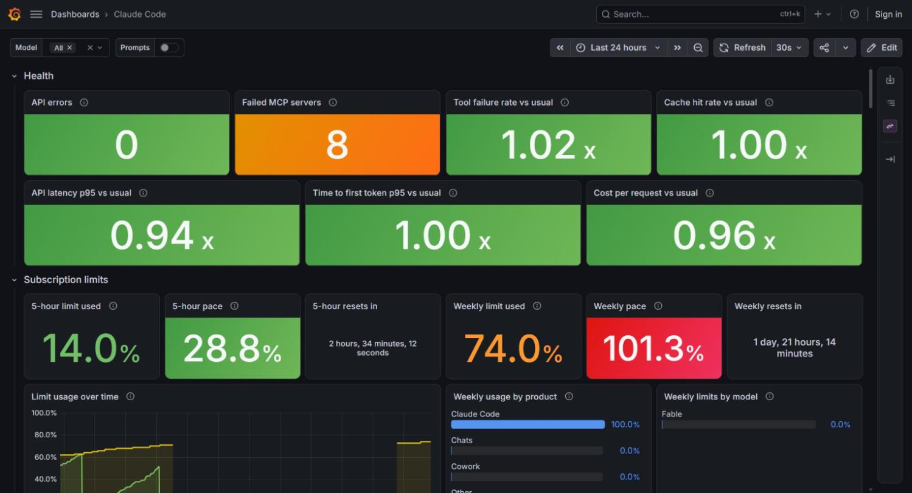
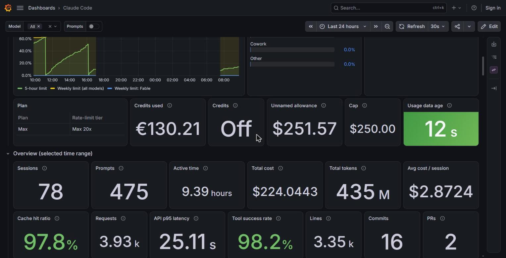
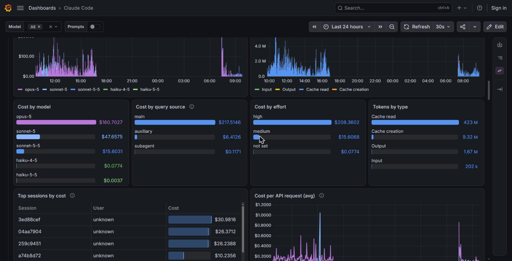
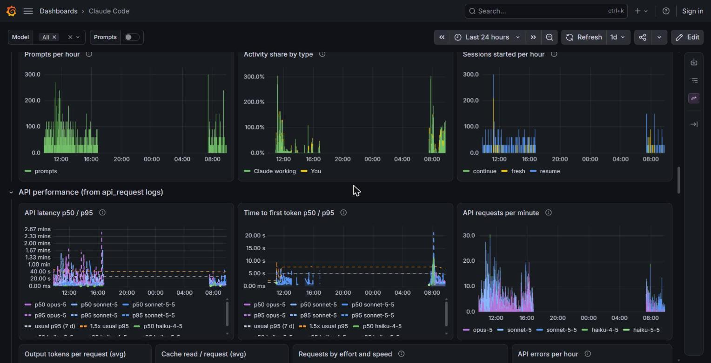
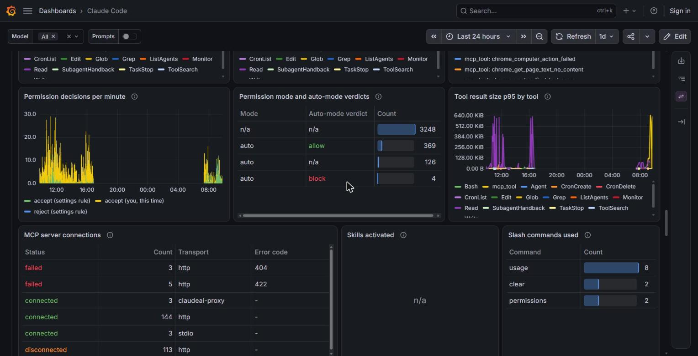
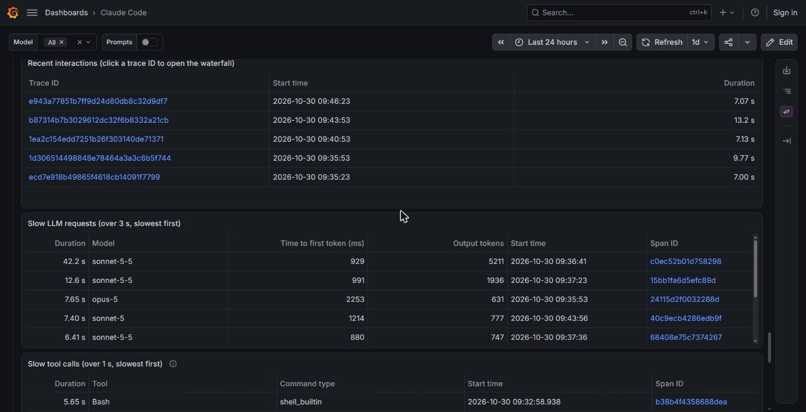
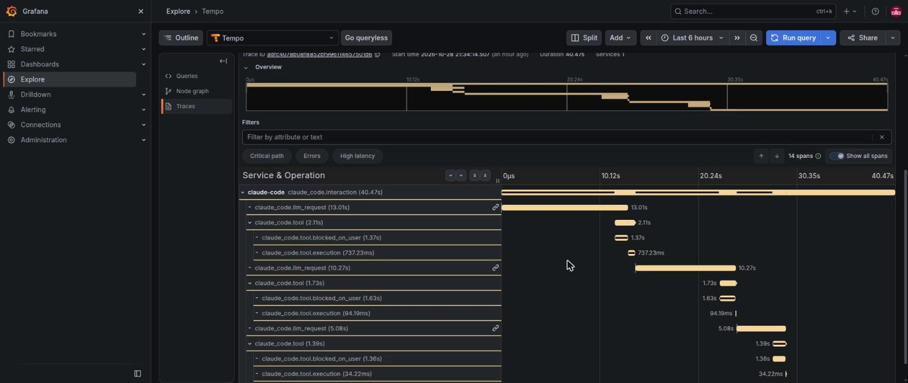
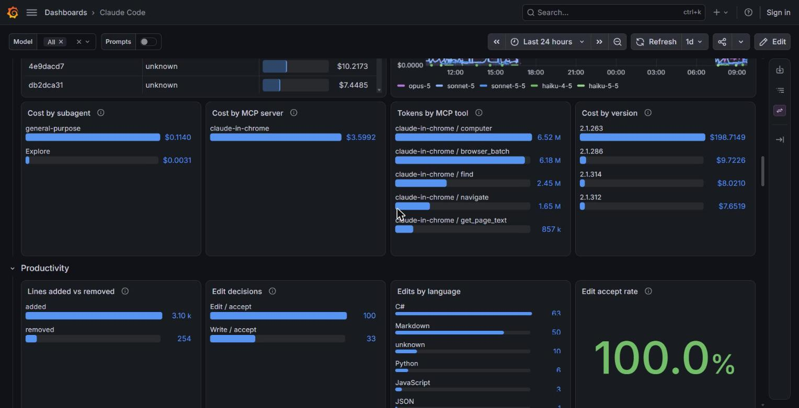
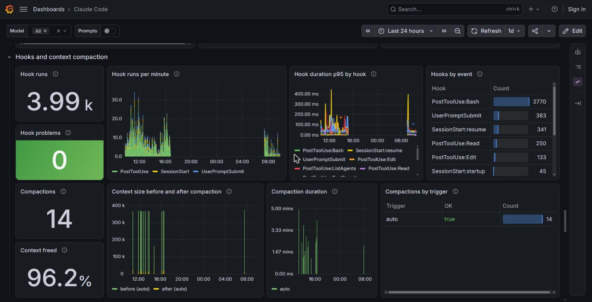
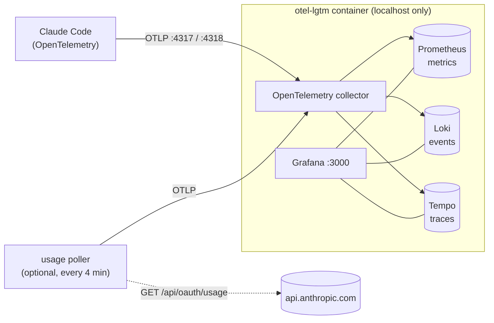

<div align="center">

# Claude Code Grafana

**See what your Claude Code sessions cost, how fast they are, and what they actually do.**
A local Grafana dashboard for Claude Code's OpenTelemetry data: cost and tokens, productivity, API and tool performance, subagents, hooks, context compaction, **full trace waterfalls**, and (optionally) your subscription limits. One command to install, everything stays on your machine.

[](LICENSE)




</div>

> **Unofficial.** This project is not affiliated with or endorsed by Anthropic. It reads telemetry that Claude Code itself emits.

## Highlights

- **Health at a glance.** Green, orange or red tiles that compare *now* with *your own* last 7 days (latency, time to first token, cost per request, tool failures, cache hits). No magic thresholds, so they fit any setup.
- **Cost and tokens.** By model, effort and query source, plus cost by subagent, MCP server and Claude Code version, the MCP tools that fill your context, and the cache hit rate that quietly drives your bill.
- **Productivity.** Lines added and removed, edit accept rate, commits, prompts, active time.
- **Tools, permissions and MCP.** Which tools run, how long they take, what fails, what gets approved or blocked, MCP server status and errors, skills, slash commands and plugins.
- **Subagents, hooks and compaction.** What subagents cost, which hooks are slow or blocking, and how often the context was compacted and how much it shrank.
- **Trace waterfalls.** Click any interaction and see every LLM request and tool call on a timeline, including how long a tool *waited for your permission* versus how long it *ran*.
- **Subscription limits** (opt-in). 5-hour and weekly usage, resets, and a *pace* tile that warns when you are on course to hit a limit before it resets.
- **Easy to read.** Short names instead of raw identifiers (`opus-5`, "Cache read"), one colour per model on every chart, rates instead of raw counts so charts read the same at 15 minutes or 7 days, and a clear "none in this range" when there is nothing to show.

## Quick start

You need Linux with systemd, [Podman](https://podman.io/) 4.4 or newer, `curl` and `python3`. On Debian or Ubuntu: `sudo apt-get install -y podman curl python3`.

```bash
git clone https://github.com/moverhorst-pitcrew/claude-code-grafana.git
cd claude-code-grafana
./install.sh --claude-settings
```

Then open <http://127.0.0.1:3000>, log in with `admin` / `admin` and **change the password**. The Claude Code dashboard is the home page. Finally, **start a new Claude Code session**: settings are read at startup, so sessions that were already running do not report.

The first start downloads the Grafana image, which can take a few minutes. The script waits for it.

<details>
<summary>What <code>install.sh</code> does</summary>

1. Checks that Podman, systemd, curl and Python are available (clear message if not).
2. Installs a rootless **systemd user service** (`otel-lgtm.service`, a Podman Quadlet) that runs [`grafana/otel-lgtm`](https://github.com/grafana/docker-otel-lgtm): Grafana, Tempo (traces), Loki (logs), Prometheus (metrics) and an OpenTelemetry collector, bound to localhost.
3. Provisions the dashboard and removes the image's sample dashboards.
4. Enables *lingering* (`loginctl enable-linger`) so the stack starts at boot without a login. Skip with `--no-boot`.
5. With `--claude-settings`: adds the OpenTelemetry variables to Claude Code's `settings.json` (a backup `settings.json.bak-pre-otel` is made first).

It is safe to run again. See `./install.sh --help`.
</details>

## Screenshots

<table>
  <tr>
    <td width="50%"><a href="docs/screenshots/02-overview.jpg"></a><br><sub><b>Overview</b>: sessions, cost, tokens and success rates. Tiles turn green, orange or red when they cross a line.</sub></td>
    <td width="50%"><a href="docs/screenshots/03-cost-and-tokens.jpg"></a><br><sub><b>Cost and tokens</b> by model, effort and query source, plus the most expensive sessions. A model keeps its colour on every chart.</sub></td>
  </tr>
  <tr>
    <td width="50%"><a href="docs/screenshots/04-productivity-and-api.jpg"></a><br><sub><b>Productivity and API performance</b>. The dashed orange and white lines are your own usual p95; p95 series are dashed.</sub></td>
    <td width="50%"><a href="docs/screenshots/05-tools-and-mcp.jpg"></a><br><sub><b>Tools, permissions, MCP servers and slash commands</b>. Blocked actions and failed servers stand out in red.</sub></td>
  </tr>
  <tr>
    <td width="50%"><a href="docs/screenshots/06-traces-and-slow-calls.jpg"></a><br><sub><b>Recent interactions and slow calls</b>. Click a trace or span ID to open it.</sub></td>
    <td width="50%"><a href="docs/screenshots/07-trace-waterfall.jpg"></a><br><sub><b>Trace waterfall</b>: one interaction with its LLM requests, tool calls, permission waits and execution times.</sub></td>
  </tr>
  <tr>
    <td width="50%"><a href="docs/screenshots/08-cost-attribution.jpg"></a><br><sub><b>Where the money goes</b>: cost by subagent, MCP server and Claude Code version, and the MCP tools that use the most tokens.</sub></td>
    <td width="50%"><a href="docs/screenshots/09-hooks-and-compaction.jpg"></a><br><sub><b>Hooks and context compaction</b>: hook runs, duration and problems; compactions, context before and after, and how long they took.</sub></td>
  </tr>
</table>

## How it works



Claude Code sends three signals: **metrics** (cost, tokens, sessions, lines, commits), **logs/events** (every API request, tool call, permission decision, subagent run) and **traces** (spans for interactions, LLM requests and tool calls). The dashboard combines all three.

## Subscription limits (opt-in)

Usage limits are not part of Claude Code's telemetry, so a small poller fetches them the same way `/usage` does and pushes them into the stack. It is **off by default**:

```bash
./install.sh --usage-poller
```

Please read this first:

- It reads your Claude Code login from `~/.claude/.credentials.json` (or `$CLAUDE_CONFIG_DIR`) and calls `https://api.anthropic.com/api/oauth/usage`, an **undocumented endpoint** that may change or be restricted at any time.
- The access token is used in memory for that single request. It is never printed, logged or stored, and the poller never refreshes it (that would log Claude Code out). The code is short: [`usage-poller/poll_usage.py`](usage-poller/poll_usage.py).
- It polls every 4 minutes and backs off after an HTTP 429. The "Usage data age" tile shows how fresh the data is.
- It only works where the login is a file (Linux). macOS Keychain and Windows storage are not supported.
- Dry run without sending anything: `python3 usage-poller/poll_usage.py --dry-run`.

You get 5-hour and weekly usage, reset countdowns, per-model weekly limits, usage by product, usage credits, and a **pace** tile: used so far divided by the part of the window already gone. Orange from 85%, red above 100% means you would hit the limit before it resets.

## How the colours work

Green, orange and red always mean *fine*, *watch this* and *act*; everything else stays neutral, so a colour always means something.

**The Health row** is not tied to one setup. Each tile compares the selected range with **your own last 7 days**:

| Tile | Rule |
|---|---|
| API latency p95, time to first token p95 | p95 now / p95 over 7 days. 1.00x = as usual |
| Cost per request | mean cost per request now / over 7 days |
| Tool failure rate | failure share now / over 7 days (lightly smoothed) |
| Cache hit rate | hit share now / over 7 days (lower is worse) |
| API errors, failed MCP servers, hook problems | counts; a healthy setup has none, so any occurrence is orange |

Ratios turn orange at 1.5x and red at 2.5x of usual (cache hits: orange below 0.9x, red below 0.75x). With less than 7 days of history the baseline is just the data you have, so tiles read about 1.00x until something changes. Adjust the steps in `tools/gen_dashboard.py` (`UP`, `DOWN`, `BASE`).

**A few tiles use fixed lines** because "good" is the same for everyone:

| Tile | Orange | Red |
|---|---|---|
| 5-hour and weekly limit used | from 70% | from 90% |
| Pace (subscription) | from 85% | above 100% |
| Cache hit ratio | below 90% | below 75% |
| Tool success rate | below 95% | below 85% |
| Edit accept rate | below 80% | below 50% |

Tables colour their verdicts too: allowed and blocked tool calls, MCP server status, compactions that failed. Chart colours carry no health meaning: each model family keeps one colour everywhere (opus purple, sonnet blue, haiku green), and p95 lines are dashed.

## Customising the dashboard

`dashboards/claude-code.json` is generated. Edit [`tools/gen_dashboard.py`](tools/gen_dashboard.py) and regenerate; Grafana reloads the file within about 30 seconds (edits made in the Grafana UI are overwritten):

```bash
python3 tools/gen_dashboard.py > dashboards/claude-code.json
python3 tools/validate_dashboard.py --range 24h   # runs every query; 15m, 3h, 24h or 7d
```

The validator queries Grafana anonymously; set `GRAFANA_PASSWORD` if anonymous viewing is off.

Names, colours and empty states are set in one block near the end of the script, so a new label never means touching a query: `RENAMES` and `CELL_MAPS` (Grafana's *rename by regex* transformation and value mappings), `MODEL_COLORS`, `STAT_STEPS` (the colour lines) and `EMPTY_IS_GOOD`.

## Without systemd (plain container)

On macOS, or where you cannot use systemd, run the container yourself (Docker or Podman; Grafana must stay on localhost):

```bash
docker run -d --name otel-lgtm --restart unless-stopped \
  -p 127.0.0.1:3000:3000 -p 127.0.0.1:4317:4317 -p 127.0.0.1:4318:4318 \
  -e GF_DASHBOARDS_DEFAULT_HOME_DASHBOARD_PATH=/claude-dashboards/claude-code.json \
  -v "$HOME/.local/share/otel-lgtm:/data" \
  -v "$PWD/provisioning/grafana-dashboards.yaml:/otel-lgtm/grafana/conf/provisioning/dashboards/grafana-dashboards.yaml:ro" \
  -v "$PWD/dashboards:/claude-dashboards:ro" \
  docker.io/grafana/otel-lgtm
python3 claude/apply-claude-settings.py        # point Claude Code at it
```

## Operating it

```bash
systemctl --user status otel-lgtm.service       # health
systemctl --user restart otel-lgtm.service
journalctl --user -u otel-lgtm.service -f       # logs
./install.sh --uninstall                        # removes the services, keeps your data
```

Data lives in `~/.local/share/otel-lgtm`; delete that folder to wipe all stored telemetry. `python3 claude/apply-claude-settings.py --remove` takes the variables out of Claude Code's settings again.

## Troubleshooting

| Symptom | Cause and fix |
|---|---|
| Dashboard is empty | Claude Code reads its settings at startup. Start a **new** session after `--claude-settings`. |
| Logs and traces arrive but metrics do not | Claude Code sends *delta* metrics by default and Prometheus rejects them. `OTEL_EXPORTER_OTLP_METRICS_TEMPORALITY_PREFERENCE=cumulative` (already in `claude/claude-telemetry-env.json`) fixes it. |
| No traces | Traces use `CLAUDE_CODE_ENHANCED_TELEMETRY_BETA=1`, which is undocumented and may be unavailable on some versions or accounts. Metrics and logs work without it. |
| Stack does not start at boot | Lingering is off: run `sudo loginctl enable-linger $USER`. |
| "Port already in use" | Something else uses 3000, 4317 or 4318 on localhost. Free it and re-run `./install.sh`. |
| Tiles fail or totals look short on long ranges | Loki rejects queries over 30 days, and `otel-lgtm` keeps 15 days of metrics by default, so cost and token totals cover at most that. |
| "Usage data age" is orange or red | The poller is rate limited (HTTP 429) or your login token expired. It recovers once Claude Code has refreshed the token, which any use does. |

## Privacy and security

- Everything listens on `127.0.0.1`. Nothing is sent anywhere, except the image download from Docker Hub and, only if you enable the poller, one request to `api.anthropic.com`.
- Prompt and response text are **not** exported: Claude Code redacts them unless you set `OTEL_LOG_USER_PROMPTS`, which this project deliberately does not.
- Telemetry does include account identifiers (email, user and session ids) as labels. They stay in your local Grafana, so be careful before sharing screenshots (the ones here show no account details).
- Grafana ships with `admin` / `admin`: change it on first login. No credentials are stored in this repository.

## Layout

| Path | Purpose |
|---|---|
| `install.sh` | Installs and uninstalls everything (`--help` lists the options) |
| `dashboards/claude-code.json` | The generated dashboard |
| `tools/gen_dashboard.py` | **Source of truth** for the dashboard |
| `tools/validate_dashboard.py` | Runs every dashboard query at a chosen range |
| `quadlet/`, `provisioning/` | Podman service template and Grafana provisioning |
| `claude/` | The Claude Code environment variables and the script that merges them into `settings.json` |
| `usage-poller/` | The optional subscription usage poller and its systemd units |
| `docs/screenshots/` | Images used in this README |

## Compatibility

Tested with Claude Code 2.1.314, `grafana/otel-lgtm` 0.38.1 (Grafana 13), Podman 5.7 and Ubuntu 26.04. Other Claude Code versions may rename metrics, events or fields. Issues and pull requests are welcome, especially reports from other versions or distributions.

## License

[MIT](LICENSE)
